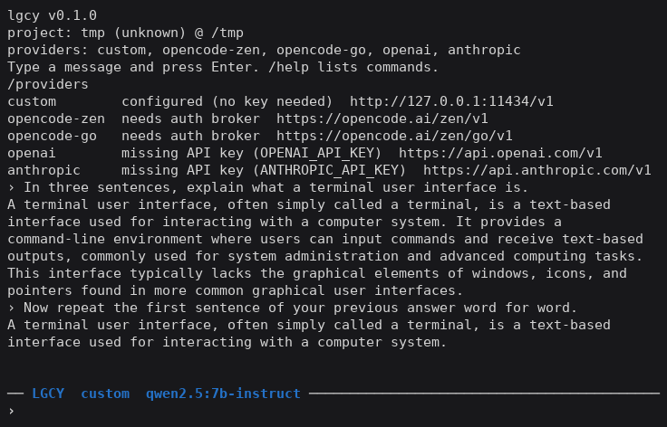
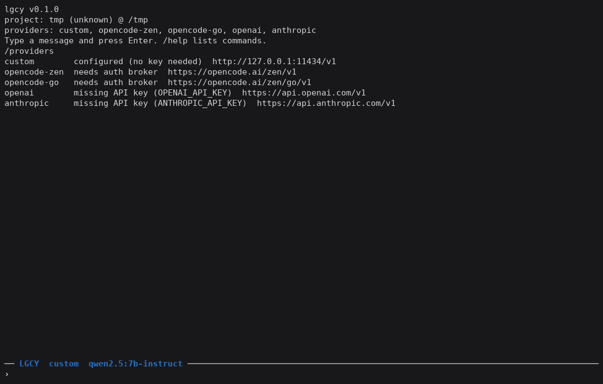
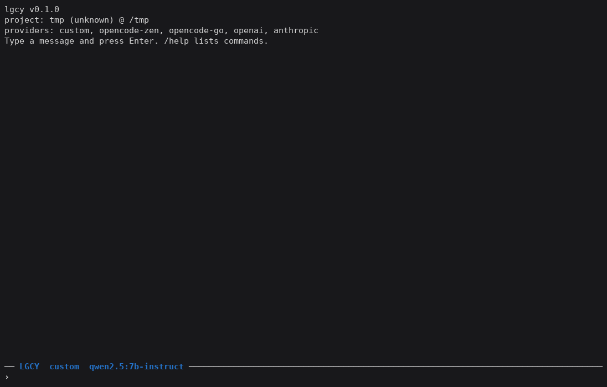
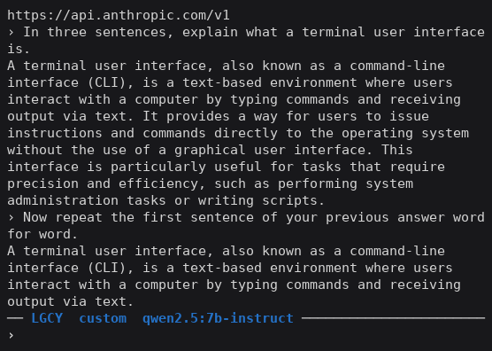

# lgcy

*Or: the terminal chat groundwork, already poured.*

LGCY is a zero-dependency Bun and TypeScript foundation for terminal chat tools, built
at Floyd's Labs / Legacy AI. If you are short on time, team bandwidth or API credits
and want your own terminal chat client, agent shell or local model front end, start
here instead of from an empty folder. No React, no Ink, no runtime dependencies.

What you get to build on:

- A differential ANSI renderer: escape codes, a screen buffer and a diffing renderer
  in about 350 lines, plus a key decoder.
- A streaming relay for OpenAI-compatible, Anthropic-compatible and OpenCode-routed
  providers, including local servers such as Ollama, with an incremental SSE parser.
- A JSONL session store that scrubs secrets before anything is written.
- Starter layers you can keep, replace or extend: `core`, `gateway`, `broker`,
  `services` and `tui`.

It also works as-is: point it at a local model or at a hosted provider with your own
key, and chat in a full-screen terminal UI.



## Get it running

Requirements: [Bun](https://bun.sh) 1.3 or newer.

```bash
bun install
bun run build                 # writes the single binary dist/lgcy
./dist/lgcy --version         # lgcy 0.1.0
```

### Talk to a local model (Ollama)

```bash
ollama pull qwen2.5:7b-instruct
LGCY_BASE_URL=http://127.0.0.1:11434/v1 LGCY_MODEL=qwen2.5:7b-instruct ./dist/lgcy
```

Type a message and press Enter. The reply streams in, and the conversation keeps its
context, so a follow-up such as "repeat your first sentence" works.

### Environment

| Variable | Meaning |
|---|---|
| `LGCY_BASE_URL` | OpenAI-compatible endpoint, e.g. `http://127.0.0.1:11434/v1`. `OPENAI_BASE_URL` is also accepted. |
| `LGCY_API_KEY` | Key for that endpoint. Optional: local servers need none. |
| `LGCY_MODEL` | Model to use when none has been saved with `/model`. |
| `OPENAI_API_KEY`, `ANTHROPIC_API_KEY` | Keys for the hosted providers. |

Keys are read from the environment at request time and are never written to disk.
An optional local auth broker can also supply credentials; LGCY works without it.

## Commands

| Command | Action |
|---------|--------|
| `/help` | List commands |
| `/providers` | Show each provider, whether it is configured, and its endpoint |
| `/model <name>` | Set and save the default model |
| `/tasks` | Show the task list |
| `/clear` | Clear the conversation and start a fresh context |
| `/exit` | Quit |



## Keys

- `Enter` sends the message or runs the command.
- `Esc` clears the input line.
- `Backspace` deletes a character.
- `Ctrl+C` or `/exit` quits and restores the terminal.

Long lines wrap to the terminal width, and the input line keeps the end of what you
are typing in view. `/clear` keeps the banner, status bar and prompt.





Screenshots are real captures from the compiled binary talking to a local Ollama
model (`qwen2.5:7b-instruct`) at 60x20, 80x24 and 120x36. No mockups.

## Where your data goes

Sessions are saved under `~/.lgcy/sessions/` as JSONL. The `~/.lgcy` directory is
created with mode `0700` and session files with `0600`. A message is saved only after
the model answers, so a failed request leaves nothing behind. Secrets are scrubbed
before any write.

## Develop

```bash
bun install
bun test             # 313 tests
bun run typecheck    # bun x tsc --noEmit (strict)
bun run src/app/main.ts
```

### Architecture

Single package, layered by directory (see `docs/adr/0001-runtime-and-architecture.md`).
Dependencies point strictly downward.

```
src/
  core/       domain contracts, lifecycle, resilience (zero deps)
  gateway/    provider adapters, SSE parser, stream normalization, relay
  broker/     optional auth-broker client + secret resolver
  services/   sessions, files, project, git, settings, tasks
  tui/        ANSI codes, screen buffer, differential renderer, key decoder, commands
  app/        composition root + interactive entry point
```

A `UnifiedChatRequest` flows through the gateway relay:

```
UnifiedChatRequest
  -> providers.ts   (URL + auth headers, registry resolution)
  -> translate.ts   (unified -> OpenAI / Anthropic wire body)
  -> fetch (abort + timeout)
  -> sse.ts         (incremental SSE parser)
  -> normalize.ts   (dialect normalizer, exactly-one-terminal guarantee)
  -> UnifiedStreamEvent stream
```

Every failure maps to an `UpstreamError.source` (`local-config | local-validation |
gateway-transport | timeout | cancelled | provider | stream-parser`) and is preserved
end to end.

`CredentialReference` names where a secret lives; it never holds the value.
`createSecretResolver` resolves `env`, `auth-broker` and `none` references into
request-time secrets.

## Release smoke checklist

CI runs the tests, the typecheck, the build and the binary's `--version` and `--help`.
Before a release, also check in a real terminal:

1. `./dist/lgcy` starts and the banner lists providers.
2. A message to a local model gets a reply, and a follow-up keeps context.
3. `Esc` clears the input; arrow keys do not leave stray characters.
4. `/clear` keeps the banner, status bar and prompt.
5. `/exit` restores the cursor, raw mode and the main screen.

## Why We Use the AGPL-3.0 License

At Floyd's Labs / Legacy AI, we built LGCY as a foundational terminal chat TUI substrate
to solve a recurring engineering headache and save you the groundwork. If you are short
on time, development resources or API credits, it gives you a working, zero-dependency
starting point so you can spend your energy building your own layers on top.

We release LGCY under the GNU Affero General Public License v3 (`AGPL-3.0-or-later`) for
three plain reasons:

- **Open Exchange:** We believe in putting real foundational building blocks into the
  hands of independent developers, self-hosters and hobbyists for unhindered personal
  and local use.
- **The Give-Back Rule:** If you take this module, modify it and expose it to the public
  over a network, such as a cloud app or hosted API service, the AGPL-3.0 requires you
  to make your modified source code available under these same open rules.
- **Passive Protection:** This license keeps our self-funded, independent lab work a
  shared community asset. It stops proprietary platforms from repackaging our
  foundation into closed-source commercial services without contributing back.

If you are building tools for yourself, tinkering locally, or playing by the rules of
open-source reciprocity, this foundation is yours to use. See [`LICENSE`](LICENSE) for
the full terms.
